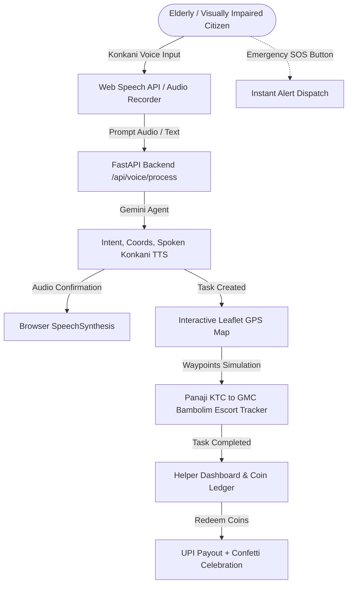

# Sahayak AI — Frontend Specification & Implementation Architecture Document

> **Document Version:** 1.0.0  
> **Target Platform:** Web (Mobile-First Responsive PWA / Desktop Admin)  
> **Tech Stack:** React 19, Vite 8, Leaflet / React-Leaflet, Lucide Icons, Canvas-Confetti, Web Speech API  
> **Associated Backend:** FastAPI ([Conclave/backend/app/main.py](file:///home/sudhanshunaik/Projects/Projects/AI%20Conclave%20Hackathon/Conclave/backend/app/main.py))

---

## 1. Executive Summary & Purpose

**Sahayak AI** is a Konkani-first voice assistant and verified human helper marketplace designed to empower senior citizens, visually impaired individuals, and persons with disabilities across Goa, India.

While the backend currently exposes Gemini-powered natural language processing, waypoint GPS routing, helper matchmaking, coin economics, and emergency alerts, the frontend must deliver an **accessible, empathetic, and intuitive user interface** that bridges the digital divide.



---

## 2. Accessibility & Design System Principles

Given the primary target audience (seniors and visually impaired users), the frontend must prioritize:

| Principle | Implementation Rule |
| :--- | :--- |
| **High Contrast & Readability** | Minimum 4.5:1 text contrast ratio, crisp fonts (Inter/Outfit), clean dark/light mode with amber & emerald accents. |
| **Generous Touch Targets** | Interactive buttons and cards minimum 56px height for easy tapping by shaky or elderly hands. |
| **Bilingual Dual-Display** | Every interaction displays both natural **Konkani** (Devanagari / Romanized Romi script) and **English translation**. |
| **Audio-First Feedback** | Immediate voice readbacks using browser `SpeechSynthesis` so visually impaired users hear confirmations without reading the screen. |
| **Zero Typing Barrier** | 1-tap preset buttons and voice recording so users can execute tasks completely hands-free. |

---

## 3. Core Screens & Component Specifications

The frontend will be organized into a multi-tab or single-page tabbed dashboard with five core views:

```
┌────────────────────────────────────────────────────────────────────────┐
│                        SAHAYAK AI (सहायक AI)                           │
│  [🎙️ Voice Assistant]  [🗺️ Live Map]  [🤝 Helper Portal]  [📊 Admin]   │
└────────────────────────────────────────────────────────────────────────┘
```

### Screen 1: Konkani Voice Assistant (Citizen Interface)
**Primary Purpose:** Allow elderly or blind citizens to request a companion or assistance using spoken Konkani.

* **Components & Elements:**
  * **Pulsing Voice Orb / Microphone Button:**
    * Large 96px circular pulsing button that listens via Web Speech Recognition (`webkitSpeechRecognition`).
    * Real-time visual audio waveform indicator.
  * **Quick Sample Prompts (1-Tap Chips):**
    * *"Maka GMC hospitalak vochunk sahayak zai"* (I need a helper to go to GMC Hospital).
    * *"Panaji KTC bus standak escort zai"* (I need an escort at Panaji bus stand).
    * *"District Hospital Mapusa vhorunk konn asa?"* (Is someone available for Mapusa hospital?).
    * *"Mhaka ration dukanant vochunk adhar zai"* (I need assistance going to the ration shop).
  * **AI Processing & Result Card:**
    * Detected Intent badge (`hospital_visit`, `public_transport`, etc.).
    * Spoken Konkani Response (written in Devanagari & Romi script).
    * English Translation for transparency.
    * Confidence score indicator (e.g., `96% match`).
    * Audio replay button (`🔊 Aikanvya / Listen Again`).
  * **Extracted Route Preview:**
    * Pickup Location (e.g., *Panaji KTC Bus Stand*).
    * Destination (e.g., *Goa Medical College (GMC) Bambolim*).
    * Estimated duration & reward: *45 mins • 50 Sahayak Coins*.
  * **Primary Action:**
    * *"Sahayak Sodha (Confirm & Find Helper)"* button that triggers `POST /api/tasks`.

---

### Screen 2: Interactive Live Goa Map & Escort Tracker
**Primary Purpose:** Visual proof of helper matching, live GPS tracking, and step-by-step hackathon demo simulation.

* **Components & Elements:**
  * **Leaflet Map Container (`react-leaflet`):**
    * Centered over Goa (`15.4989, 73.8278`).
    * Custom map tiles with smooth zoom controls.
  * **Custom Markers:**
    * **Pickup Marker (Green Pin):** User's starting landmark (e.g., Panaji KTC).
    * **Destination Marker (Red Pin):** Arrival point (e.g., GMC Hospital Bambolim).
    * **Helper Marker (Blue Pulsing Pin with Photo):** Live location of matched volunteer (e.g., Rahul Naik).
    * **Goa Landmark POIs:** Quick markers for Mapusa Market, Margao Railway Station, Ponda Bus Stand.
  * **Route Polyline:**
    * Highlighted line depicting the journey from Panaji KTC through Santa Cruz / Bambolim bypass to GMC.
  * **Demo Simulation Controller Bar (Crucial for Hackathon Presentations):**
    * Step-by-step stepper controls:
      1. `requested` (Searching for helper near Panaji...)
      2. `matched` (Rahul Naik accepted! 4.95 ⭐)
      3. `in_progress` (Rahul moving along NH66...)
      4. `arrived` (Rahul arrived at GMC Bambolim)
      5. `completed` (Task finished! Coins awarded)
    * *"Simulate Next Step"* button calling `POST /api/tasks/{task_id}/simulate-step` to update the map pin coordinates dynamically.

---

### Screen 3: Verified Helper Marketplace & Coin Wallet
**Primary Purpose:** Allow local Goan youth and volunteers to view assistance requests, build community trust, and redeem earned reward coins for real cash.

* **Components & Elements:**
  * **Helper Profile Header:**
    * Name: *Rahul Naik*, Rating: *4.95 ⭐ (32 reviews)*.
    * Verification Badges: `🛡️ Goa Police Cleared` • `🆔 Aadhaar Verified` • `🩺 First Aid Trained`.
    * Languages spoken tags: *Konkani, English, Hindi, Marathi*.
  * **Coin Balance Card:**
    * Balance display: `240 Sahayak Coins` (`₹240 INR value`).
    * Lifetime earnings and completed tasks counter (`18 tasks completed`).
  * **Available Requests Feed:**
    * Cards showing active citizen requests from `GET /api/tasks`.
    * Service type tag, distance from helper, pickup point, and reward (`+50 Coins`).
    * *"Accept Task"* button calling `POST /api/tasks/{task_id}/accept`.
  * **UPI Cash-Out Redemption Modal:**
    * Input for coin amount (e.g., `100 Coins`).
    * UPI ID field (pre-filled with `rahul@oksbi`).
    * Live exchange rate calculation (`1 Coin = ₹1.00 Direct Bank Transfer`).
    * *"Redeem to Bank"* button calling `POST /api/helpers/{helper_id}/redeem`.
    * **Celebration Effect:** Full-screen celebratory confetti burst (`canvas-confetti`) upon successful payout.

---

### Screen 4: Emergency SOS Floating Action Button & Modal
**Primary Purpose:** Immediate safety valve for vulnerable citizens who feel lost, unwell, or threatened.

* **Components & Elements:**
  * **Persistent Red SOS FAB:**
    * Fixed to bottom-right or top header across all views with high z-index.
    * Glowing red pulse animation.
  * **SOS Activation Dialog:**
    * 3-second abort countdown with prominent warning audio tone.
    * Sends instant payload to `POST /api/emergency/sos` with GPS coordinates.
  * **Active Emergency Banner:**
    * Dispatched confirmation showing simulated SMS alerts sent to Goa Police (112), GMC Emergency, and registered family members.

---

### Screen 5: Hackathon Admin & Community Impact Dashboard
**Primary Purpose:** Present the macro-level impact, economic viability, and scalability to hackathon judges.

* **Components & Elements (Powered by `GET /api/admin/metrics`):**
  * **Metric Stat Cards:**
    * Total Verified Helpers (e.g., `3 Active Volunteers`).
    * Registered Users / Senior Citizens (e.g., `142`).
    * Completed Companionship Escorts (e.g., `12+`).
    * Circulating Coin Economy (e.g., `₹715 INR`).
    * Average Helper Trust Rating (e.g., `4.93 / 5.0`).
  * **Real-Time Activity Ledger (`GET /api/transactions`):**
    * Live scrollable feed of all completed tasks, rewards earned, and UPI redemptions.

---

## 4. Proposed Frontend Directory Architecture

```
Conclave/frontend/src/
├── assets/                  # Logos, badges, and Goa landmark icons
├── components/
│   ├── common/              # Buttons, Cards, Badges, Tabs, AudioWaveform
│   │   ├── Header.jsx       # App brand, language toggle, and SOS button
│   │   ├── TabNavigation.jsx
│   │   └── AudioSpeaker.jsx # TTS audio player wrapper
│   ├── voice/
│   │   ├── VoicePromptInput.jsx   # Mic recorder + prompt chips
│   │   ├── VoiceResponseCard.jsx  # Spoken Konkani + English translation
│   │   └── TaskConfirmModal.jsx   # Final dispatch trigger
│   ├── map/
│   │   ├── GoaLiveMap.jsx         # Leaflet container with markers & polyline
│   │   ├── SimulationStepper.jsx  # Step-by-step demo controller
│   │   └── LandmarkCard.jsx       # Location info overlays
│   ├── helper/
│   │   ├── HelperCard.jsx         # Verified helper credentials & badge
│   │   ├── AvailableTasksList.jsx # Requests feed
│   │   └── CoinWalletModal.jsx    # UPI redemption + canvas-confetti
│   ├── emergency/
│   │   └── SOSModal.jsx           # Emergency dispatch overlay
│   └── admin/
│       ├── MetricsOverview.jsx    # Stats cards
│       └── TransactionLedger.jsx  # Financial rewards stream
├── services/
│   └── api.js               # Centralized Axios/fetch client for FastAPI backend
├── hooks/
│   ├── useSpeechRecognition.js # Speech-to-text hook
│   └── useSpeechSynthesis.js   # Browser text-to-speech audio reader
├── index.css                # Global tokens, accessibility variables & resets
├── App.jsx                  # Main application orchestrator
└── main.jsx                 # React root bootstrap
```

---

## 5. API Integration Mapping

| Screen / Feature | Backend API Endpoint | Method | Payload / Response |
| :--- | :--- | :--- | :--- |
| **Voice Processing** | `/api/voice/process` | `POST` | Input prompt -> Returns intent, Konkani response, coords. |
| **Create Task** | `/api/tasks` | `POST` | Pickup, dest coords, service type -> Returns new task. |
| **List Tasks** | `/api/tasks` | `GET` | Returns all active & past assistance tasks. |
| **Accept Task** | `/api/tasks/{task_id}/accept` | `POST` | Assigns helper to task (`matched` state). |
| **Simulation Step** | `/api/tasks/{task_id}/simulate-step` | `POST` | `step_index: 0..4` -> Moves helper along NH66. |
| **Complete Task** | `/api/tasks/{task_id}/complete` | `POST` | Completes task & credits 50 coins to helper. |
| **List Helpers** | `/api/helpers` | `GET` | Fetches Rahul, Priya, Amit with ratings & balances. |
| **Redeem Coins** | `/api/helpers/{id}/redeem` | `POST` | Coin amount + UPI ID -> Transacts INR bank payout. |
| **Trigger SOS** | `/api/emergency/sos` | `POST` | User ID, location -> Triggers emergency response. |
| **Admin Metrics** | `/api/admin/metrics` | `GET` | Summary statistics for judges' presentation. |

---

## 6. Implementation Checklist & Recommended Steps

1. **Phase 1: API Service Layer (`src/services/api.js`)**
   * Configure Axios/Fetch pointing to `http://localhost:8000` with standard error handling.
2. **Phase 2: Voice Assistant & Speech Synthesis (`src/components/voice/`)**
   * Integrate Web Speech Recognition with Konkani preset fallback buttons.
   * Add automated browser `speechSynthesis` playback of the returned Konkani audio response.
3. **Phase 3: Interactive Leaflet Map & Simulator (`src/components/map/`)**
   * Render Leaflet map with custom marker icons for Panaji KTC and GMC Bambolim.
   * Connect "Simulate Step" button to `/api/tasks/{id}/simulate-step` to showcase live helper movement.
4. **Phase 4: Helper Marketplace & Confetti Rewards (`src/components/helper/`)**
   * Display helper cards with police verification badges.
   * Implement UPI coin redemption modal with `canvas-confetti` fireworks.
5. **Phase 5: Emergency SOS & Admin Impact Tab**
   * Add high-contrast red SOS button and admin metrics dashboard for hackathon judging.
